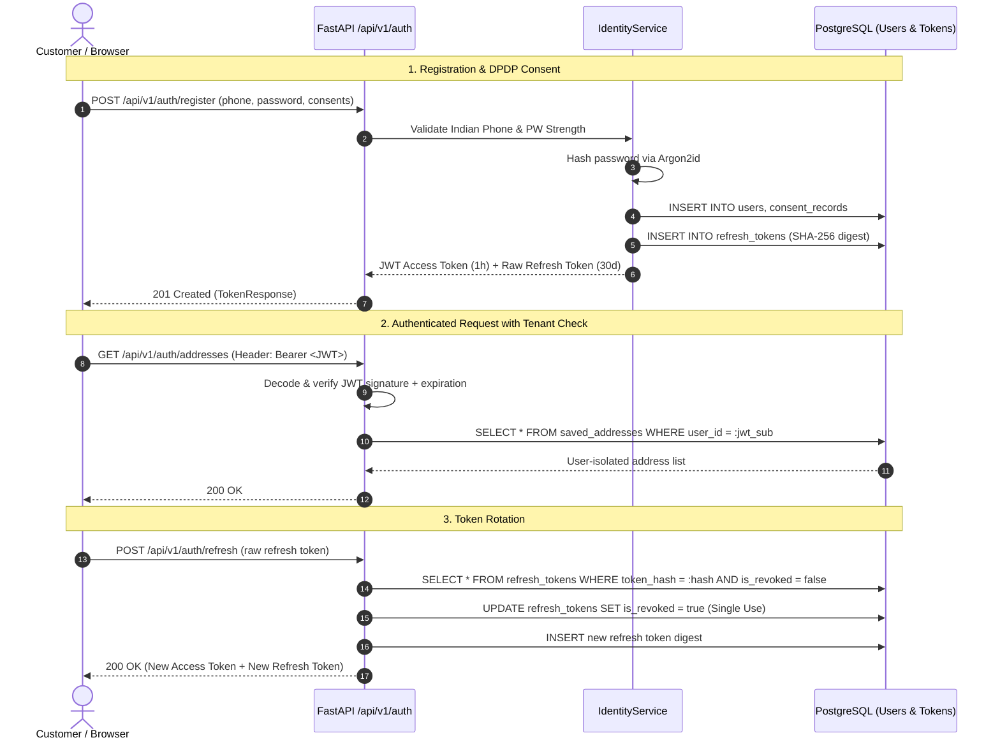

# GlamNow Authentication & Role-Based Access Control (RBAC)

**Document Version:** 1.0.0  
**Status:** Approved & Enforced  
**Last Updated:** October 21, 2026  

---

## 1. Security Architecture & Threat Model

GlamNow enforces zero-trust identity verification on the backend:
1. **Server-Enforced Role Claims:** Frontend role state is advisory only. Roles (`customer`, `professional`, `operations_staff`, `admin`) are strictly resolved from authenticated session records in the database.
2. **Zero Plaintext Secret Logging:** Passwords, refresh tokens, auth headers, and intimate customer measurements are scrubbed and never written to standard application logs.
3. **OWASP-Compliant Cryptography:**
   - **Password Hashing:** Argon2id via `argon2-cffi` (`time_cost=3`, `memory_cost=65536` KiB, `parallelism=4`).
   - **Access Tokens:** Signed JWTs using HMAC-SHA256 with 60-minute expiration.
   - **Refresh Tokens:** High-entropy opaque strings (`gn_rt_*`) stored in the database as SHA-256 digests with 30-day expiration and automatic rotation on use.
4. **DPDP Act 2023 Compliance:** Mandatory, versioned consent logging (`terms_of_service`, `privacy_policy`, `measurement_storage`) with client IP and user-agent records.

---

## 2. Role Hierarchy & Permission Matrix

```text
┌─────────────────┐       ┌──────────────────────┐
│  Administrator  │ ───►  │ Operations Staff     │
└─────────────────┘       └──────────────────────┘
         │                           │
         ▼                           ▼
┌─────────────────┐       ┌──────────────────────┐
│  Professional   │       │  Customer            │
└─────────────────┘       └──────────────────────┘
```

| Action / Capability | Customer | Professional | Operations Staff | Administrator | Enforced Policy |
|:---|:---:|:---:|:---:|:---:|:---|
| **Public Registration** | ✅ | ❌ (Onboarding API) | ❌ | ❌ | Restricted to `customer` |
| **View Own Profile** | ✅ | ✅ | ✅ | ✅ | `get_current_user` |
| **Manage Saved Delivery Addresses** | ✅ | ❌ | ❌ | ❌ | Tenant-scoped `user_id == current_user.id` |
| **Book Services / Instant Hold** | ✅ | ❌ | ❌ | ❌ | `require_role(CUSTOMER)` |
| **View Customer Bookings** | ✅ (Own only) | ❌ | ✅ | ✅ | `verify_customer_ownership` |
| **View Assigned Professional Jobs** | ❌ | ✅ (Assigned only) | ✅ | ✅ | `verify_booking_access` |
| **Access Tailoring Measurements** | ✅ (Own only) | ✅ (Active job only) | ❌ | ✅ (Audited) | `verify_tailoring_measurement_access` |
| **Catalog Price & Tier Mutation** | ❌ | ❌ | ✅ | ✅ | `verify_catalog_mutation_permission` |
| **Professional Verification / Approval** | ❌ | ❌ | ✅ | ✅ | `require_role(OPERATIONS_STAFF, ADMIN)` |

---

## 3. Authentication & Token Lifecycle



---

## 4. Resource Authorization Policies

All authorization policies are codified in [`backend/app/modules/identity/dependencies.py`](file:///Users/kumargaurav/Desktop/GlamNow/backend/app/modules/identity/dependencies.py) and applied as FastAPI dependencies before any handler code executes:

### 4.1 Cross-Customer Data Isolation
- Queries must always filter by `user_id == current_user.id`.
- If Customer A requests Customer B's saved address, the repository returns `None` which translates to an HTTP 404 (Not Found). This prevents attackers from enumerating resource IDs across customers.

### 4.2 Professional Job Assignment Policy
```python
def verify_booking_access(booking_customer_id, assigned_pro_id, current_user):
    # Customer can access their own booking
    if current_user.role == UserRole.CUSTOMER and current_user.id == booking_customer_id:
        return
    # Professional can only access jobs actively assigned to them
    if current_user.role == UserRole.PROFESSIONAL and current_user.id == assigned_pro_id:
        return
    # Operations staff & Admins can access for intervention
    if current_user.role in (UserRole.ADMIN, UserRole.OPERATIONS_STAFF):
        return
    raise ForbiddenError("You are not authorized to view or manage this booking")
```

### 4.3 Sensitive Tailoring Measurement Policy (DPDP Act)
```python
def verify_tailoring_measurement_access(customer_id, assigned_master_tailor_id, current_user, is_job_active=True):
    # Customer has access to their own measurements
    if current_user.id == customer_id:
        return
    # Master tailor has access ONLY while the job is actively in workshop progress
    if current_user.id == assigned_master_tailor_id and is_job_active:
        return
    # System administrator for support audit
    if current_user.role == UserRole.ADMIN:
        return
    raise ForbiddenError("Sensitive tailoring measurement data is restricted under privacy policy")
```

---

## 5. Security Test Suite Matrix

Automated verification tests are maintained in `backend/tests/unit/test_identity_security.py` and `backend/tests/integration/test_auth_api.py`:

- **Unauthorized Access:** Requests to protected endpoints without a token return `401 Unauthorized`.
- **Expired Sessions:** Tokens with past expiration timestamps return `401 Unauthorized` with an explicit expiry message.
- **Role Escalation:** Customers attempting to access admin probes or mutate the catalog return `403 Forbidden`.
- **Cross-Customer Access:** Customer B attempting to retrieve or delete Customer A's saved address returns `404 Not Found`.
- **Replay Protection:** Attempting to reuse an already rotated refresh token returns `401 Unauthorized`.
- **Input Validation:** Weak passwords (<8 chars, no digit/uppercase), non-Indian phone formats, and missing consent flags return `422 Unprocessable Entity`.
