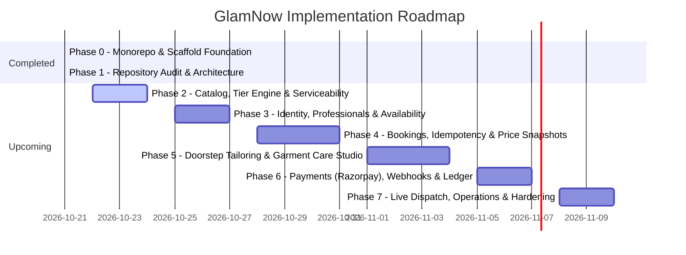

# GlamNow Implementation Plan & Phased Roadmap

**Plan Version:** 2.0.0  
**Last Updated:** October 21, 2026  
**Current Milestone:** Phase 1 Complete (Audit & Target Architecture Established)  
**System State:** Monorepo with Next.js 16.4.2 frontend, FastAPI backend, 16 passing unit tests, and ADRs recorded.

---

## 1. Delivery Objective

Build a production-grade, highly extensible Indian marketplace for quick at-home services and doorstep tailoring.
- **Customers:** Discover eligible nearby professionals in 15–30 mins, compare Basic/Standard/Premium tiers, pick specific verified professionals, book instant or scheduled visits, schedule doorstep custom tailoring (saree pico-fall, blouse/kurti tailoring, alterations) with home measurement/fabric pickup, pay idempotently, and track live order dispatch.
- **Professionals:** Manage service tiers, active availability, GPS dispatch acceptance, and earnings.
- **Operations:** Manage dynamic catalog versions, serviceability zones, professional background verification, and dispute resolution.

---

## 2. Phase Execution Status & Prioritized Roadmap



---

## 3. Prioritized Implementation Phases & Acceptance Criteria

### Phase 0 — Foundation & Quality Boundary (COMPLETED)
- **Delivered:** Monorepo scaffolding with `/frontend` and `/backend`.
- **Backend:** FastAPI, Pydantic v2, structured logging, correlation IDs, error handlers, async database lifecycle, and 16 unit tests.
- **Frontend:** Next.js 16.4.2 App Router, Tailwind v4 design tokens, TanStack Query provider, accessible UI primitives, Header/Footer, and interactive landing page.
- **Infrastructure:** Docker Compose for PostgreSQL 16 and Redis 7; root `.env.example`.
- **Status:** Committed in `v1` (`89599ea`).

---

### Phase 1 — Repository Audit & Target Architecture (COMPLETED)
- **Delivered:** 
  - [`docs/architecture/repository-audit.md`](./repository-audit.md) recording real baseline check metrics, dependency inventories, hardcoded data, and security gaps.
  - [`docs/architecture/target-architecture.md`](./target-architecture.md) detailing bounded contexts, data models, state machines, and DPDP compliance.
  - [`docs/architecture/decisions/`](./decisions/) containing ADR-0001 through ADR-0007.
  - Prioritized roadmap and file-level implementation plan.
- **Status:** Completed.

---

### Phase 2 — Catalog, Multi-Tier Engine & Serviceability (Next Priority)
**Focus:** Replace hardcoded frontend categories, tiers, and PIN code checks with versioned database models and public REST endpoints.

**Deliverables:**
1. Database tables: `service_categories`, `service_types`, `service_tier_versions`, `service_add_ons`, and `service_area_polygons`.
2. Alembic migration generation and automated database seed script (`scripts/seed_catalog.py`).
3. Domain services:
   - `CatalogService`: Effective-dated querying (`valid_from <= NOW() <= valid_to`).
   - `ServiceabilityService`: Point-in-polygon and PIN code lookup for 15–30 min serviceability.
4. FastAPI endpoints:
   - `GET /api/v1/catalog/categories`
   - `GET /api/v1/catalog/services/{service_id}/tiers`
   - `POST /api/v1/serviceability/check` (validates PIN code & returns active zone metadata)
5. Frontend integration: Connect `frontend/src/app/page.tsx` and catalog hooks to dynamic backend endpoints using TanStack Query.

**Acceptance Criteria:**
- Modifying a tier price in the database reflects immediately on the frontend without redeploying code.
- Out-of-zone PIN codes return an explicit non-serviceable response with waitlist registration.
- Historical tier version records cannot be overwritten; edits create new versions.
- All unit and integration tests for catalog queries pass.

---

### Phase 3 — Identity, Professional Discovery & Availability
**Focus:** User authentication, role-based access control, professional verification profiles, and real-time dispatch availability.

**Deliverables:**
1. User models: `User`, `Role` (Customer, Professional, Tailor, Operations Admin), `ProfessionalProfile`, `ProfessionalOffering`.
2. Auth endpoints: OTP authentication, JWT access/refresh token issuance, and passwordless authentication.
3. Professional discovery:
   - `GET /api/v1/professionals`: Filtering by category, tier qualification, real rating, review counts, and live arrival ETA.
   - `GET /api/v1/professionals/{id}`: Detailed profile with verified portfolio photos and verified reviews.
4. Availability engine: Working hours, buffer intervals (15–30 min travel buffers), and Redis-backed active geolocation heartbeat.

**Acceptance Criteria:**
- Only verified professionals with active equipment kits appear in discovery results.
- Sensitive customer data (phone number, full address) is hidden from professionals until booking dispatch.
- Concurrent availability queries respond in under 50ms using indexed geospatial queries and Redis caches.

---

### Phase 4 — Bookings, Idempotency & Immutable Price Snapshots
**Focus:** Two-phase reservations, conflict prevention, atomic slot holds, and tamper-proof price snapshots.

**Deliverables:**
1. Booking models: `Booking`, `BookingItem`, `BookingPriceSnapshot`, `BookingStatusHistory`.
2. Two-phase reservation workflow:
   - `POST /api/v1/bookings/hold`: Creates 10-minute slot hold using Redis distributed locks and DB exclusion constraints.
   - Captures immutable JSON snapshot of tier inclusions, base price, add-ons, CGST/SGST tax, and arrival ETA.
3. Mandatory `Idempotency-Key` middleware to prevent double booking.
4. Customer booking tray and checkout review UI in Next.js.

**Acceptance Criteria:**
- Two simultaneous requests for the same professional slot result in exactly one hold; the second receives an HTTP 409 Conflict.
- Retrying a booking with the same `Idempotency-Key` returns the cached response without creating duplicate database records.
- In-flight catalog price changes do not alter the price of an active held booking.

---

### Phase 5 — Doorstep Custom Tailoring & Garment Care Studio
**Focus:** Multi-stage tailoring fulfillment, measurement profiles, doorstep fabric collection, and alterations rework.

**Deliverables:**
1. Tailoring models: `TailoringOrder`, `GarmentItem`, `MeasurementProfile`, `CustodyEvent`, `AlterationRequest`.
2. Field-level AES-256 encryption for sensitive customer measurements (DPDP Act compliance).
3. 4-step tailoring UI flow:
   - Garment selection (Saree pico-fall, blouse, kurti, suit alterations).
   - Measurement mode: Master Tailor Home Visit vs. Sample Garment Pickup vs. Saved Profile.
   - Doorstep fabric collection scheduling.
   - Live workshop stage tracker (`CUTTING` -> `STITCHING` -> `QC` -> `OUT_FOR_TRIAL`).

**Acceptance Criteria:**
- Orders support heterogeneous garments with independent workshop stages.
- Tailor measurement data is accessible only by authorized staff and the assigned master tailor during the active job window.
- Alteration requests spawn a linked rework task without altering original payment records.

---

### Phase 6 — Payments (Razorpay), Webhook Verification & Ledger
**Focus:** Secure, idempotent payment capture, webhook reconciliation, and automated refunds.

**Deliverables:**
1. Integration port: `PaymentGatewayPort` with `RazorpayPaymentAdapter` and `MockPaymentAdapter`.
2. Endpoints:
   - `POST /api/v1/payments/create-order`
   - `POST /api/v1/payments/webhook` (HMAC SHA-256 signature verification)
3. Payment state machine: `INITIATED` -> `AUTHORIZED` -> `CAPTURED` / `REFUNDED`.
4. Idempotent webhook processor ensuring duplicate gateway callbacks are safely ignored.

**Acceptance Criteria:**
- Frontend redirect manipulation cannot confirm a booking without verified backend webhook or signature verification.
- Failed or timed-out bookings release the professional slot hold automatically.
- Zero customer card credentials or UPI PINs touch application servers.

---

### Phase 7 — Live Dispatch Tracking, Operations Portal & Hardening
**Focus:** End-to-end operational visibility, GPS dispatch simulator, start/complete OTP verification, and production security review.

**Deliverables:**
1. Live dispatch simulation: Pro arrival countdown, GPS travel update, and 4-digit start/completion OTP verification.
2. Operations portal: Catalog version editor, professional background check approvals, dispute management, and audit trails.
3. Production hardening: Rate limiting (slowapi/Redis), security headers, automated backup/restore scripts, and Playwright end-to-end tests.

**Acceptance Criteria:**
- End-to-end flow passes: PIN code check -> Tier comparison -> Pro selection -> Booking hold -> Payment -> OTP start -> Completion -> Review.
- All endpoints conform to OpenAPI schemas and pass automated security and performance scans.

---

## 4. Proposed File-Level Implementation Plan (Next Slice: Phase 2)

To advance directly into Phase 2, the following exact files will be created and modified:

```text
backend/
├── alembic/
│   └── versions/
│       └── 0001_initial_catalog_and_serviceability.py  # First migration
├── app/
│   ├── modules/
│   │   ├── catalog/
│   │   │   ├── models.py         # Category, ServiceType, ServiceTierVersion, AddOn
│   │   │   ├── schemas.py        # Pydantic v2 request/response schemas
│   │   │   ├── repository.py     # Async database query operations
│   │   │   └── service.py        # Version resolution and pricing logic
│   │   └── serviceability/
│   │       ├── models.py         # ServiceZone, PincodeMapping
│   │       ├── schemas.py        # Pincode query and zone response schemas
│   │       ├── repository.py     # Zone and polygon queries
│   │       └── service.py        # Point-in-polygon and ETA calculation
│   ├── api/v1/
│   │   ├── catalog.py            # Public catalog & tier comparison endpoints
│   │   └── serviceability.py     # Pincode check & zone availability endpoints
│   └── scripts/
│       └── seed_catalog.py       # Indian salon, groom & tailoring seed dataset
└── tests/
    ├── unit/
    │   ├── test_catalog_service.py
    │   └── test_serviceability.py
    └── integration/
        └── test_catalog_api.py

frontend/
├── src/
│   ├── features/
│   │   ├── catalog/
│   │   │   ├── api.ts            # Typed queries for categories & tiers
│   │   │   └── hooks.ts          # useCategories, useServiceTiers
│   │   └── discovery/
│   │       ├── api.ts            # Typed query for PIN code check
│   │       └── hooks.ts          # useServiceability
│   └── app/
│       └── page.tsx              # Hydrate landing page with real backend API hooks
```
