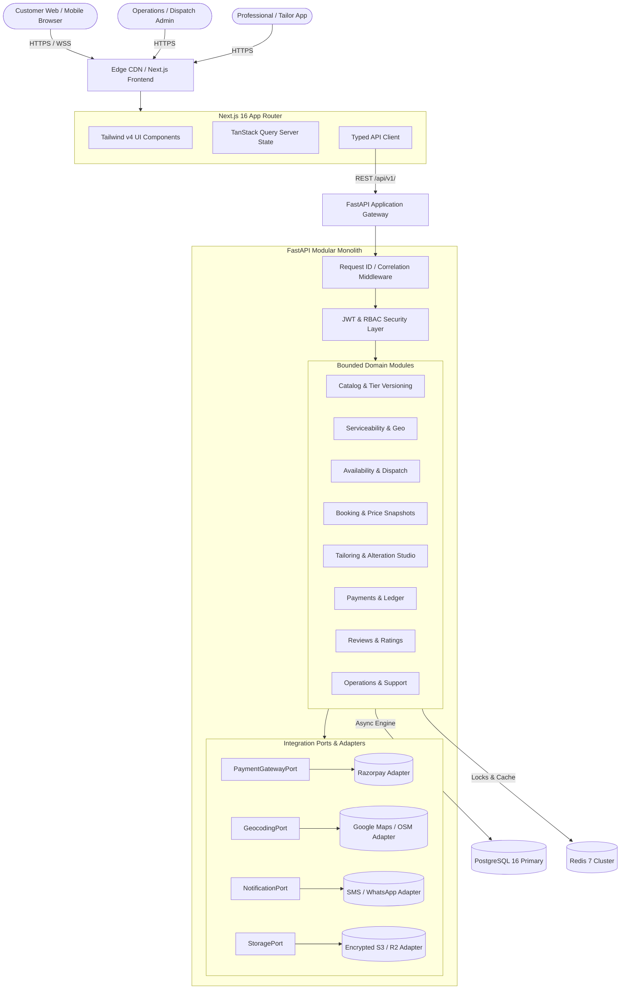
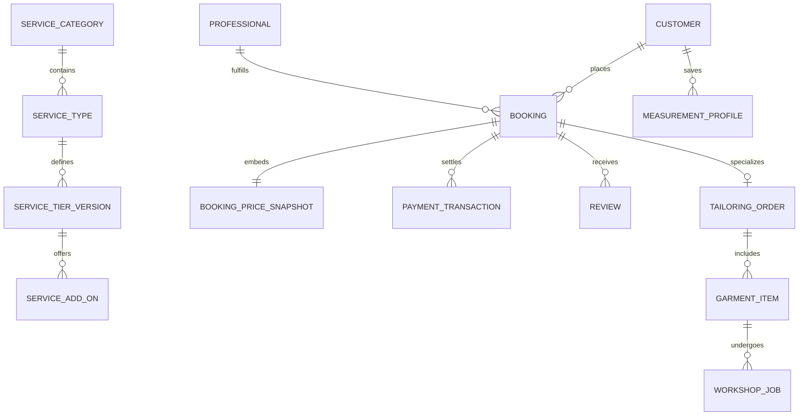
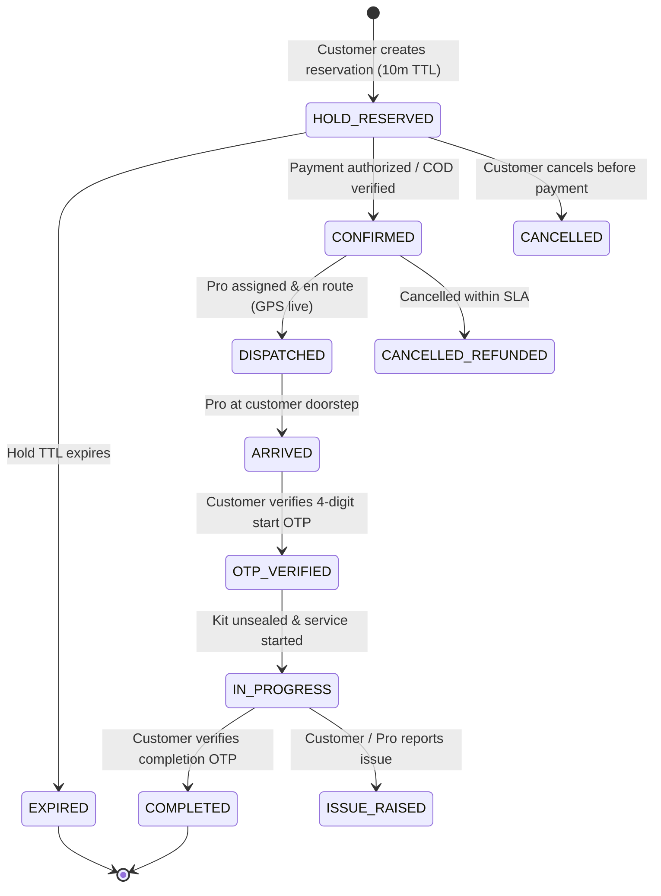
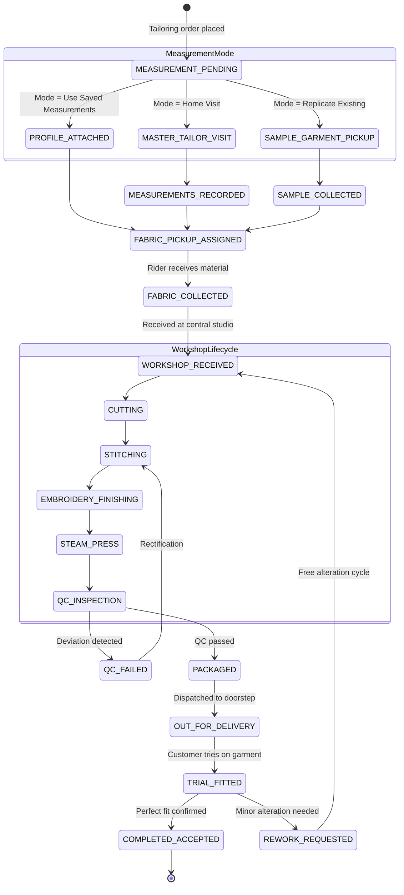

# GlamNow Target Architecture Specification

**Document Version:** 1.0.0  
**Status:** Approved  
**Last Updated:** October 21, 2026  

---

## 1. System Vision & Topology

GlamNow is engineered as a high-throughput, extensible Indian marketplace platform for quick-commerce at-home beauty, grooming, spa, and bespoke custom tailoring. 

The architecture balances two critical priorities:
1. **Low Latency & High Responsiveness:** 15–30 minute dispatch estimates, dynamic tier comparison, and immediate booking confirmation under mobile network constraints.
2. **Strict Domain Integrity & Auditability:** Versioned service catalogs, immutable booking price snapshots, and multi-step tailoring fulfillment state machines.



---

## 2. Bounded Contexts & Domain Modules

The backend operates as a **Modular Monolith** (`backend/app/modules/`) where each module encapsulates its database models, schemas, repositories, and domain services. Cross-module database writes are strictly prohibited; inter-module communication occurs via explicit service interfaces or asynchronous domain events.

| Module | Core Responsibility | Key Invariants |
|:---|:---|:---|
| `catalog` | Categories, services, tiers (Basic, Standard, Premium), duration rules, and effective-dated pricing rules. | Historic versions are immutable. Catalog updates write new version records. |
| `serviceability` | Operating cities, geo-fenced delivery polygons, PIN code mappings, and travel time buffers. | Quick-booking is disabled for addresses outside active polygon boundaries. |
| `professionals` | Profiles, onboarding verification, skills, tier qualifications, and equipment kit status. | Unverified pros or expired background checks cannot be assigned to customer bookings. |
| `availability` | Working hours, slot generation, travel-time buffers, and real-time dispatch availability. | Buffer intervals (15–30 mins) prevent overlapping commitments. |
| `bookings` | Customer reservations, slot holds, pricing calculation, immutable snapshot generation, and order lifecycle. | Holds expire in 10 minutes without payment. Double booking impossible due to exclusion constraints. |
| `tailoring` | Garment specifications, measurement profiles, doorstep fabric collection tasks, workshop jobs, and alteration rework. | Individual garments track discrete workshop states. Measurements are field-encrypted. |
| `payments` | Gateway integrations (Razorpay), webhook signature validation, idempotency, refund calculation, and settlement records. | Zero charge execution without an active booking hold and valid idempotency key. |
| `reviews` | Customer ratings, verified review validation, and professional aggregate score recalculation. | Only customers with `COMPLETED` bookings can submit verified reviews. |
| `support` | Booking disputes, cancellation escalations, and satisfaction rework requests. | Rework tickets link directly to the originating order snapshot. |

---

## 3. Data Model & Entity Relationship Architecture



### 3.1 Immutable Booking Price Snapshot
To prevent pricing discrepancies, every booking stores a JSONB snapshot captured at reservation time:
```json
{
  "service_type_id": "srv_hair_spa",
  "tier": "standard",
  "tier_version_id": "v2_2026_10",
  "base_price_paise": 79900,
  "currency": "INR",
  "inclusions": [
    "Cheryl's Cosmeceuticals hair spa cream",
    "10-minute scalp & shoulder relaxer",
    "Steam & ozone treatment",
    "Blowdry styling"
  ],
  "estimated_duration_minutes": 45,
  "add_ons": [
    { "id": "addon_argan_mask", "title": "Argan Hair Mask", "price_paise": 19900 }
  ],
  "discount_paise": 0,
  "tax_breakdown": {
    "cgst_paise": 8982,
    "sgst_paise": 8982,
    "rate_percent": 18
  },
  "total_paise": 117764,
  "snapshot_timestamp": "2026-10-21T12:00:00Z"
}
```

---

## 4. State Machines

### 4.1 Quick Service Booking Lifecycle



### 4.2 Doorstep Tailoring & Garment Care State Machine

Unlike standard home salon visits, custom tailoring spans physical material transport and workshop processing:



---

## 5. Security & Sensitive Privacy Architecture (DPDP Act Compliance)

1. **Measurement Privacy:**
   - Body measurements (chest, waist, hips, inseam) are categorized as Sensitive Personal Data under India's Digital Personal Data Protection (DPDP) Act 2023.
   - Storage uses field-level symmetric AES-256 encryption. Encryption keys are managed securely and rotated.
   - Tailors only receive decrypted measurements for orders actively assigned to them, restricted to the active work window.
2. **Ephemeral Image Access:**
   - Style reference images and sample garment fitting photos are stored in private object storage.
   - Browsers access images exclusively via short-lived pre-signed URLs (15-minute TTL).
   - Reference images are automatically purged 30 days after order completion unless explicitly saved by the customer.
3. **Idempotency Protection:**
   - All financial and booking mutations require an `Idempotency-Key` header (UUIDv4).
   - Keys are tracked in Redis using atomic `SET NX EX` commands to prevent double-charges and race conditions.

---

## 6. Integration Architecture (Ports & Adapters)

To ensure zero vendor lock-in and testability without external network access, all external providers implement strict abstract interfaces:

```python
# Payment Port Interface
class PaymentGatewayPort(Protocol):
    async def create_payment_order(self, amount_paise: int, currency: str, idempotency_key: str) -> PaymentOrderResult: ...
    async def verify_webhook_signature(self, payload: bytes, signature: str) -> bool: ...
    async def process_refund(self, payment_id: str, amount_paise: int, reason: str) -> RefundResult: ...

# Geocoding & Travel Estimation Port
class GeocodingPort(Protocol):
    async def validate_pincode_serviceability(self, pincode: str) -> ServiceabilityResult: ...
    async def estimate_travel_eta(self, origin_lat: float, origin_lng: float, dest_lat: float, dest_lng: float) -> TravelEtaResult: ...

# Notification Port
class NotificationPort(Protocol):
    async def send_otp(self, mobile_number: str, otp_code: str, context: str) -> bool: ...
    async def send_booking_update(self, mobile_number: str, template_id: str, parameters: dict) -> bool: ...
```

---

## 7. Quality Gates & Non-Negotiable Engineering Standards

- **Zero Untyped Persistence Writes:** No raw dictionaries or unstructured mutations to business records.
- **Client Formula Rejection:** All pricing, tax rates, surge multipliers, and discount deductions are strictly evaluated on the server.
- **Deterministic Testing:** Test suites run locally with zero network I/O; external ports are mocked using faithful memory adapters.
- **Aesthetic Excellence:** Accessible WCAG AA compliant colors, Outfit typography, responsive mobile-first views, and smooth micro-interactions.
